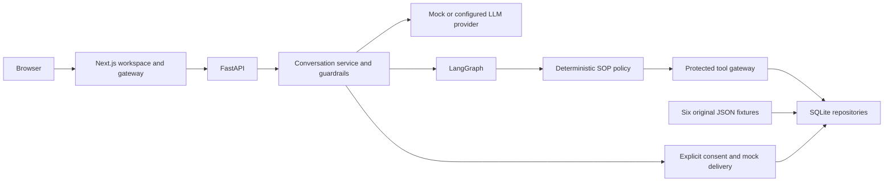
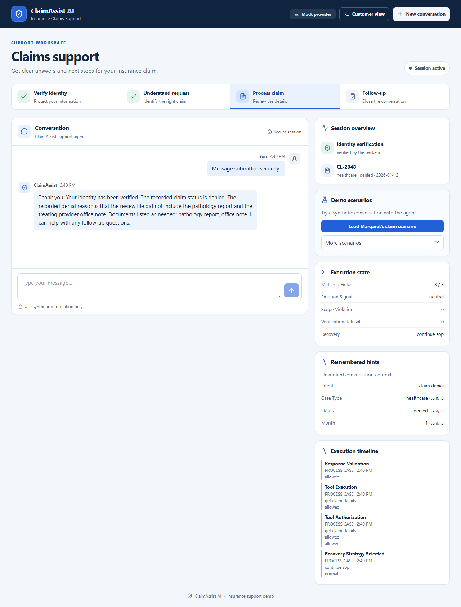

# Insurance Claims SOP Harness

A Python 3.10+ demo backend for authenticated insurance claim chat using synthetic fixtures. The SOP controls verification, case access, and workflow transitions. The demo supports fixture-backed status, denial, payments, document guidance, and appeal dates. See [SPEC.md](SPEC.md) for the contract, [AGENTS.md](AGENTS.md) for engineering rules, [PROGRESS.md](PROGRESS.md) for verified status, and [DECISIONS.md](DECISIONS.md) for architecture choices.

The backend lives in `apps/insurance_claims/`, its fixture data in `apps/insurance_claims/fixtures/`, and regression tests in `tests/`.

Next.js renders ClaimAssist and proxies session operations to FastAPI. FastAPI runs the deterministic SOP through LangGraph and reads fixture-backed evidence from SQLite. The LLM contributes typed proposals. The backend controls verification, case authorization, phase changes and email consent. See [architecture](docs/ARCHITECTURE.md).

## Architecture and security

The LLM interprets the conversation and proposes responses. Deterministic backend code controls what the agent is authorized to do.



The four phases are `VERIFY_ID`, `RESOLVE_INTENT`, `PROCESS_CASE`, and `POST_PROCESS`. Verification requires three distinct approved fields matching one eligible policyholder. The gateway and repository enforce claim ownership. Session credentials stay in HttpOnly cookies in the browser flow. The service remembers claim hints across phases, retrieves financial and document guidance from the fixture data, and offers simulated handoff when recovery thresholds are reached. The summary requires an explicit choice and records one durable outcome per session. Developer diagnostics are separately authorized.



## Run with Docker Compose

The Compose profile is prepared for a local synthetic demo. Configuration validation passed. Docker image builds and runtime verification are pending on a host with a Linux container engine.

```powershell
docker compose --env-file .env.example config --quiet
docker compose up --build --wait
```

Open `http://127.0.0.1:3000`. The default needs zero credentials, and SQLite uses a named volume. See the [deployment guide](docs/DEPLOYMENT.md) for configuration, health checks and shutdown, and the [demo guide](docs/DEMO_GUIDE.md) for the walkthrough.

The Compose commands are the same in PowerShell and Bash. For the native setup on Linux or macOS, use `python3 -m venv .venv`, then use `.venv/bin/python` in place of `.\.venv\Scripts\python.exe`. The frontend defaults to the local backend URL. Copy its environment template only if you need a local override.

## Run locally

From the repository root in PowerShell:

```powershell
python -m venv .venv
.\.venv\Scripts\python.exe -m pip install -e ".[test]"
.\.venv\Scripts\python.exe -m uvicorn apps.insurance_claims.api:app --no-proxy-headers
```

Demo startup seeds SQLite at `./data/insurance.db`. The mock provider is the default and needs no credentials. The server exposes `/health` and `/ready`. A separate seed command is available as `python -m apps.insurance_claims.database demo.sqlite3` from the project environment.

For the browser workspace, install Node.js 24 and npm. Start the backend above, then use a separate terminal:

```powershell
Set-Location frontend
npm ci
Copy-Item .env.example .env.local
npm run dev
```

Open `http://127.0.0.1:3000`. The same-origin gateway uses the server-only `BACKEND_API_URL`. To enable Developer view, configure the same private `DEMO_DIAGNOSTICS_KEY` in backend and frontend environments and enter it when prompted. Unlocking is bound to the current session. The backend independently requires demo mode and authorizes each diagnostics request. Browser credentials are stored in an HttpOnly cookie. Use synthetic data only.

## Configuration

Use environment variables or copy [.env.example](.env.example) to an ignored local `.env`. `DATABASE_URL` takes a SQLite URL, and `BUSINESS_TIMEZONE` controls appeal-date comparisons (default `America/Chicago`). Windows installs `tzdata` through the project dependencies. `DEMO_MODE=true` seeds the synthetic fixtures.

For the OpenAI adapter, set `LLM_PROVIDER=openai`, `LLM_MODEL`, and `LLM_API_KEY` in the backend environment. Choose a Chat Completions model supporting JSON output and the configured temperature. Keep the key out of source and client code. Use synthetic data for live evaluation.

## Demo walkthrough

Select **Load Margaret’s claim scenario** and send the synthetic opening. The app verifies three factors, resolves claim `CL-2048`, and explains the recorded denial. Ask about missing paperwork, direct submission, payment, and appeal. Say “That's everything.” Review the summary and select **Send email summary** or **Skip email**. Repeat in a fresh session to see the other outcome. [Full walkthrough](docs/DEMO_GUIDE.md)

## Send a chat message

> I'm the policyholder. My name is Margaret Chen, policy POL-9921. I'm calling about my denied healthcare claim from January. DOB is 1985-03-15, SSN last four is 4472.

The [independent review](docs/FINAL_REVIEW.md) recorded 20/20 synthetic scenarios and classified final submission as **NOT_READY** pending Docker runtime and configured-model evidence.

```powershell
$base = 'http://127.0.0.1:8000'
$session = Invoke-RestMethod -Method Post "$base/api/v1/sessions"
$headers = @{ Authorization = "Bearer $($session.credential)" }
$body = @{ message_id = 'first'; message = 'I am calling about my denied healthcare claim from January.' } | ConvertTo-Json
Invoke-RestMethod -Method Post "$base/api/v1/sessions/$($session.session_id)/messages" -Headers $headers -ContentType 'application/json' -Body $body
```

Reuse the bearer credential and a fresh message ID for each new turn. Use the original ID and identical message to replay a request safely. The reply includes the current phase and next expected action.

Use **Load Margaret’s claim scenario** in the browser to prefill a synthetic message. Send it, ask a follow-up, then say “That's everything.” The backend returns a summary preview. With `EMAIL_MODE=mock`, **Send email summary** records simulated delivery, and **Skip email** records a decline. Neither sends a real email. **Consent timeout** is a separate developer-only simulation and cannot authorize a summary.

## Troubleshooting

- For a `404` on a session operation, check the matching bearer credential and create a fresh session if it expired. Incomplete identity candidates may need to be supplied again after a restart.
- For a `409`, use a fresh message ID if the text changed.
- If readiness fails, check the SQLite path and permissions. For startup provider configuration errors, check the model and key or select `mock` for the offline demo.
- Handoff is simulated. After asking for a person, send “Handoff status” to check the simulated queue or “Resume” to cancel and resume an eligible session. A lock or identity review needs human verification.
- Recovery limits are configurable in [.env.example](.env.example). The default client-source verification limit is 12 complete attempts per 900 seconds, shared across sessions on the same database. For an unproxied demo, launch Uvicorn with `--no-proxy-headers` so forwarded headers cannot change the source. Deployments behind a proxy require separately configured trusted attribution.
- The standard gateway is loopback-only. Requests share the backend's demo client-source verification budget. Production deployment needs trusted client attribution, TLS, and a real authentication policy.
- Live contact-center routing and external email delivery remain pending. See the [submission checklist](docs/SUBMISSION_CHECKLIST.md) for checked and pending deployment requirements.

## Test

```powershell
.\.venv\Scripts\python.exe -m pytest -q
.\.venv\Scripts\python.exe -m pytest --collect-only -q
```

Live tests are opt-in. With model and key configured, set `RUN_REAL_MODEL_EVAL=1` and run `python -m pytest -q -k real_` using the project environment.

From `frontend/`, run `npm run typecheck`, `npm run test`, `npm run build`, then `npm run test:e2e`. Browser tests start both servers against a temporary SQLite database and use installed Chrome by default. Use `PLAYWRIGHT_CHANNEL` for a different installed browser channel. `PLAYWRIGHT_PYTHON` can point to a different project interpreter.

## Evaluation and release checks

The independent review passed 102 backend tests, three frontend unit tests, ten Chromium checks and 20/20 synthetic scenarios. Three opt-in real-provider tests were skipped. See the [independent review](docs/FINAL_REVIEW.md) and [measured evaluation](evaluation/reports/phase10_deterministic.json).

From the repository root, using the project environment:

```powershell
python -m evaluation.run --provider mock --output evaluation/reports/deterministic_results.json
python -m evaluation.run --provider configured --output evaluation/reports/real_model_status.json
```

Use `--scenario MARGARET_SEND` or `--category guidance` for a focused run. Configured mode requires a real `LLM_PROVIDER`, `LLM_MODEL`, and `LLM_API_KEY` and records NOT_EXECUTED if they are unavailable. Evaluation uses synthetic data and simulated email.

See the [evaluation report](docs/EVALUATION_REPORT.md), [requirements matrix](docs/REQUIREMENTS_TRACEABILITY.md), and [security audit](docs/SECURITY_AUDIT.md) for measured results and delivery limits.

## Project structure and limitations

| Path | Contents |
| --- | --- |
| `apps/insurance_claims/` | API, orchestration, policy, repositories, and original fixtures |
| `frontend/` | Next.js workspace, same-origin gateway, and Chromium tests |
| `tests/`, `evaluation/` | Backend regressions, dataset, and measured results |
| `scripts/`, `docs/` | Smoke and packaging commands, architecture, and release evidence |

The demo uses synthetic data, single-node SQLite, simulated email and simulated handoff. Representative self-service fails closed pending an approved authentication policy. National ID is excluded from the approved factor list. The OpenAI transport has offline contract coverage. Live model behavior and Docker runtime acceptance remain open. Production use needs separate identity, privacy, and deployment controls. See the [submission checklist](docs/SUBMISSION_CHECKLIST.md).
