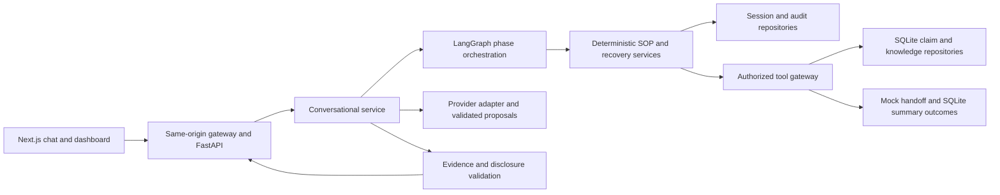
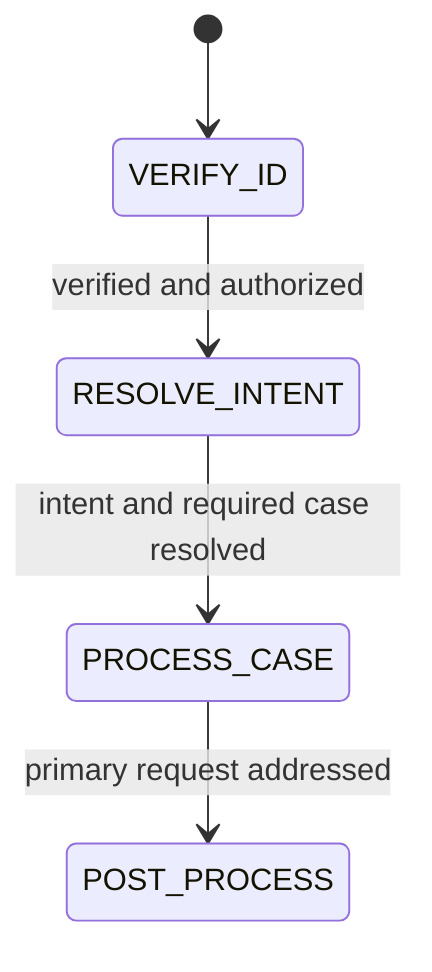

# Insurance Claims SOP Harness Specification

## Purpose and scope

Deliver a text-chat demo that verifies a caller, identifies their insurance request, answers from authorized records and approved guidance, and offers an optional email summary. Use the supplied synthetic fixtures. A single FastAPI backend and a Next.js frontend are sufficient. Claim adjudication, claim mutation, live customer records, and production identity proofing are outside the demo scope.

## Current foundation and target stack

| Area | Current workspace | Target |
| --- | --- | --- |
| Business enforcement | `sop.py` and `sop.yaml` enforce phase order and named guards. Structured turns verify identity, resolve owned claims, lock repeated failures, and gate inquiry completion on answered topics and empty pending work. | Expand conversational recovery and add authorized summary delivery. |
| Data and tools | Typed fixture validation, owner-scoped claim and guidance tools, evidence validation, SQLite sessions, redacted audits, isolated consent simulation, and mock handoff. | Add live handoff and email adapters. |
| Runtime | Python 3.10+, FastAPI, LangGraph, Pydantic v2, SQLite, provider-independent mock, OpenAI, and Gemini adapters, and React/Next.js with TypeScript. | See the [README results](README.md#verification-results) for configured-provider evidence. |
| Delivery and tests | Seed CLI, health, session and chat API, pytest and Playwright coverage. | Docker images and the hosted mock workflow were verified. See the [current results](README.md#verification-results). |

The conversational service turns redacted natural-language messages into typed candidates and passes them into the existing deterministic graph. The graph resolves intent from validated candidates and owner-scoped evidence. Case discussion and post-processing use trusted completion and summary choice operations. Runtime representative verification and external email sending remain unavailable. Partial identity values are held in process memory for the demo and are lost on restart. SQLite stores candidate field names, sanitized user history, and an isolated replay record. Claim facts are rendered from authorized tool values.

## Architecture and authority

The FastAPI chat handler invokes the conversational service. It extracts protected fields locally and passes redacted context to the provider through its abstraction. LangGraph consumes the validated candidates and performs bounded memory updates, phase routing and case resolution. The conversational service then gathers authorized evidence, validates the response and stores the replay result inside the SQLite transaction. The implemented provider supports analysis and constrained reply framing. Summary drafting remains planned. Deterministic services own verification, authorization, phase changes, protected tool execution and disclosure, escalation thresholds, trusted state updates, email consent, and session completion. Model output and user-supplied instructions have no write path to those decisions.

## SOP phases and transition guards

| Phase | Allowed actions | Guard and restrictions |
| --- | --- | --- |
| `VERIFY_ID` | Collect and correct identity fields, explain verification, retain future intent and claim hints, answer approved general verification questions, offer handoff. | A unique, authorized identity with at least three distinct matching PII fields and no unresolved conflicts sets `identity_verified`. Protected claim access and confirmation of existence are forbidden. |
| `RESOLVE_INTENT` | Reuse hints, classify insurance needs, search only the authorized owner's claims, ask targeted questions. | A supported intent and a single authorized resolved case for claim-specific work set `intent_resolved`. A supported general request can proceed without a case. |
| `PROCESS_CASE` | Read authorized claim evidence and approved knowledge, answer follow-ups, offer handoff. | Trusted processing marks the primary request addressed or records a supported disposition before setting `case_processed`. Claim changes and adjudication require a separately authorized workflow. |
| `POST_PROCESS` | Review summary, record send or skip, handle further authorized case questions, hand off, close. | Close after the customer chooses skip or the accepted send reaches a confirmed disposition, or on a separately authorized termination event. Any further case question uses the existing phase and ownership checks. A materially changed pending summary requires renewed consent. |

On a failed guard, stay in the current phase. Handoff and closure are session dispositions. Use safe YAML loading and a registry of named Python predicates. Reject unknown guards, skipped or reordered transitions, and configurations missing mandatory guards. Never evaluate guard expressions from YAML.

### Identity and representative authorization

- Approved factors are full name, DOB, phone, email, and SSN last four. Normalize whitespace and case as appropriate, canonicalize supported phone formats, parse DOB as a date, and keep the four digits as a strict string. Match registered aliases within their original field. Count each field once and require all supplied factors to be consistent with one candidate.
- Policy number narrows the lookup. Caller role, representative name and relationship determine eligibility and never count toward three. Accumulate partial submissions. A correction replaces the prior value and triggers revalidation. A refusal permits an alternative approved field. Count submitted mismatches against configurable limits and offer human review when verification stalls. Do not reveal which customer or claim exists during unsuccessful verification.
- `national_id_last4` appears in the fixture and is excluded by the current SOP. Use other approved fields. Enabling national ID requires approval and an explicit verification-policy extension.
- Keep caller identity separate from the represented policyholder. Match representative name and relationship to the policy owner's `buyer_party_id` record. Current fixtures establish a relationship only and lack independent credentials and delegated permission. A listed representative requires human review. An unconfirmed representative also receives no protected access. Future automation requires verified caller identity, trusted authority for that policyholder and purpose, and auditable scope and expiry.
- An explicitly identified representative enters the existing review path without a provider call. Unsupported model intents leave the stored supported intent in place. Explicit case-status wording can refine the trusted owner-scoped search. A verification refusal must be supported by the caller’s current message before it increases the refusal count.

### Intent and case resolution

Recognize primary and secondary requests for status, denial, payments, documents, appeals, general claims guidance, or handoff. Extract explicit case ID, type, status, month, and year. Preserve unknown dates as unset and ask only for missing details that affect resolution. Verify ownership on a direct case ID using `party_id` and `case_id`. Search through the gateway using `ClaimFilters`. Zero matches prompt targeted clarification or human help, one supported match resolves the case, and multiple matches require a disambiguating question. An out-of-scope request does not advance this phase.

### Case processing and approved guidance

- The current tool registry allows verified callers to search and read owned claims in `RESOLVE_INTENT`, `PROCESS_CASE`, and `POST_PROCESS`. The gateway checks phase and ownership before reading claim details, status, denial, payment fields, required documents, document guidance, alternatives, follow-up rules, or appeal information. The repository applies owner scope again. There are no claim-write tools.
- The typed `Discussion` model tracks the active case, document and financial references, completed topics, pending filters and intents, and evidence references. An authorized switch resets case-specific discussion. Conversational completion requires an explicit completion signal, an answered topic for the active case, and no pending work. The SOP then transitions to `POST_PROCESS` while the claim outcome stays unchanged.
- Answer status, denial, payment and reimbursement, missing documents, document submission and alternatives, appeals, timing, submission methods, formats, receipt confirmation, and authorized insurance follow-ups. Use claim facts from the authorized repository and procedural guidance from the knowledge repository. For missing values, say that the record does not provide the information. Preserve the difference between discussion, action taken, and confirmed outcome.
- For document guidance use controlled mappings from `pathology report` to `original pathology report` and from `office note` to `treating provider office note`. Normalize for retrieval and retain the original claim labels. Apply document-specific guidance before case-type and default guidance. For alternatives prefer the item-specific entry, then its default. Ask for clarification on an ambiguous name or use approved generic guidance for unknown items.
- For direct provider submission, prefer the item-specific fixture entry when it describes direct transmission. Otherwise use approved channel guidance.
- Select follow-up entries deterministically by topic, intent, presence of required documents, and configured phrase matches. Prefer the specific topic and use the approved fallback when none applies. Render only allowlisted placeholders from authorized case data and approved settings. Use the fixture's human-review guidance when reasonable alternatives are exhausted.
- Treat document submission recommendations, recorded appeal cutoffs, and estimated processing times separately. Compare recorded appeal dates against an injectable clock in the configured business timezone. For expired or unavailable deadlines, state what the record supports and offer review. Never promise approval, acceptance of substitutes, coverage, payment, or a completion date.

### Consent, email, and completion

**Current demo implementation.** A verified completed discussion produces a backend preview and masked registered recipient when available. Send and skip accept a summary revision. Explicit chat decisions use the same transaction. The first valid choice records a unique SQLite outcome per session. Ambiguous replies remain pending. Delivery is simulated entirely in SQLite. External delivery, retry scheduling, and production recipient policy remain open.

Produce an evidence-backed summary of discussion topics, claim status, documented outcomes, and outstanding next steps. Offer send or skip. Record explicit acceptance against the summary version, recipient, session, and email purpose. Refusal skips sending. Silence, ambiguity, and unrelated acknowledgments leave consent pending. An unapproved recipient requires authorized resolution before sending. Return delivery status from the mock mail service for the demo. A pending or failed send can be retried safely or skipped. Confirm a send only from service evidence.

Use a durable unique delivery key for the approved summary and recipient. Atomically reserve the send in SQLite, deduplicate retries and concurrent requests, and pass the same key to an idempotent delivery adapter. Reconcile ambiguous service outcomes before retrying. Replays return the existing outcome.

The consent fixture contains a default sequence of pending then approved, and a timeout sequence of five pending results. Neither fixture nor current code identifies the intended consent purpose. Keep them as simulations bound to a test purpose until a business purpose is approved. Representative consent never grants email permission. A timeout grants no permission.

## Structured memory and model contracts

Keep session-scoped categories for unverified customer statements, protected identity candidates, verified identity, caller authorization, intent and claim hints, resolved claim references, authoritative evidence, emotional context, scope and refusal/recovery counters, consent, workflow status, summary, and audit events. Preserve hints across phases, including useful details from mixed messages. Separate caller assertions and model hypotheses from trusted facts. Discard collected PII once verified or the session ends and bound retention for unresolved candidates. Audit events contain redacted identifiers and decisions.

Expose a provider-independent adapter for turn analysis, reply drafting, and summary drafting. Use strict Pydantic v2 schemas with enumerated intents, scope and emotion, typed optional identity fields and claim hints, explicit proposed action and validated arguments, and evidence references for factual drafts. Reject extra protected fields such as phase, verification, authorization, or delivery state. Extract sensitive identifiers locally or pass only necessary values under approved provider policy. Avoid passing raw PII to response drafting. Bound retries and tool calls and apply per-call timeouts. Validate finished responses against evidence and permission before exposing protected content. Use a deterministic fallback when validation fails.

## Scope, emotional recovery, and handoff

**Implemented demo.** Typed recovery decisions are applied to structured scope and emotion signals, explicit refusals, and trusted state. Known unrelated content is redirected even if the model misclassifies it. Mixed turns can contribute identity or case hints. Substantive insurance turns reset the consecutive scope counter. Greetings and acknowledgments do not add violations. Refused fields are excluded from later prompts. Repeated refusal, scope violations, insufficient progress, and provider failures can create an offer while keeping the phase active. Explicit acceptance creates a request. An exhausted-alternatives offer uses the approved fixture guidance.

Mock handoff records store bounded recovery metadata, a generated redacted summary, and an authorized case reference only when verified and owner-validated. Requests can be polled into a simulated queue. They can be cancelled with a recovery command. Eligible sessions resume the same phase, with fresh identity candidates when needed. Locked verification, representative review, and identity revalidation require manual review. No live dispatch or connected status is available. Requests and denials are recorded in sanitized audit events.

Input guards reject recognized attempts to override protected state or obtain internal prompts before model invocation. This pattern layer supplements typed validation, deterministic tool authorization, owner-scoped reads, and response assembly from source evidence. An explicit identity restatement after verification is handled conservatively with manual revalidation. Output checking rejects common sensitive formats. These demo safeguards require broader evaluation before production.

Politely redirect unrelated questions. Capture useful insurance details in mixed turns before redirecting the unrelated portion. Count consecutive out-of-scope attempts and reset on a return to insurance support. Recognize frustration, anger, confusion, anxiety, and refusal. Acknowledge emotion, explain verification or consent, offer allowed alternatives, avoid prompting for facts already supplied, and stop persuading after repeated refusals.

Honor an explicit request for a human in any phase. The backend also offers or initiates handoff per policy after verification limits, repeated scope violations, persistent refusals, representative review needs, exhausted document alternatives, or an unresolved service failure. Pass only the permitted summary and verification status. Report requested, queued, connected, or failed only when confirmed by the adapter. Handoff does not grant disclosure rights.

**Implemented demo defaults.** Limits are three failed complete verification submissions per session, two consecutive out-of-scope turns, two verification refusals, three stalled or frustrated turns, three failed provider turns, three tool calls per turn, and 30 minutes of session inactivity. Verification increments the session failure count only when an eligible policyholder submission reaches the distinct-field threshold and fails matching. A separate SQLite throttle reserves up to twelve complete chat verification attempts per source in a fixed 900-second window, including successful checks. It uses a keyed source fingerprint shared across sessions on that database. It is a demo limit and depends on trustworthy client attribution. Provider calls use a 30-second timeout and up to two transient retries. Mandatory verification, ownership, and explicit consent apply regardless of the defaults.

## Fixture contracts and SQLite persistence

All six files below live in `apps/insurance_claims/fixtures/`. Preserve the original files and seed from them.

| File | Contract |
| --- | --- |
| `policyholders.json` | Unique `party_id` and `policy_number`, `name`, `dob`, `phone`, `email`, `id_type`, and string `id_last4`. Optional `name_aliases`, `phone_aliases`, and `email_aliases` map to their matching fields. |
| `claims.json` | Unique `case_id` and owner `party_id`, with `case_type`, `created_at`, `status`, and `summary`. Keep optional `denial_reason`, `documents_needed`, and `appeal_deadline` absent when the fixture omits them. Derive the policy from the owner. All four P9 claims belong to `POL-9921`. |
| `claim_schema.json` | Field descriptions with USD decimal-string examples. `expected_reimbursement_amount` is expected reimbursement, `allowed_max_amount` is the allowed maximum, `net_pay` is the finalized payment, and `net_fee` is a fee schedule amount. Use Python `Decimal` for calculations and preserve decimal-string serialization. These descriptions do not constitute a formal JSON Schema. |
| `representatives.json` | `rep_name`, `relationship`, `buyer_name`, and `buyer_party_id`. Join to the policyholder by `buyer_party_id`. |
| `consent_scenarios.json` | Name-keyed `status_sequence` lists, retrieved in recorded order. An unknown name fails deterministically. |
| `required_document_guideline.json` | Default, case-type, per-document and alternative guidance, follow-up settings, topic entries with intent and phrase hints, and a fallback. Use localized text where present. |

Reuse `SQLiteCustomerRepository`, `SQLiteClaimRepository`, and `SQLiteKnowledgeRepository`. Enforce foreign keys, parameterize SQL, and apply claim owner restrictions in the database even when the gateway has already verified ownership. Target repositories for sessions, processed turn IDs, audit events, and delivery reservations use transactions and unique keys. Scope every state read and write to an authorized session. Use optimistic versioning or transactional serialization for competing turns and persist response and state together. Preserve base records on reseed and use relative deployment paths.

## API and frontend

Session creation returns an opaque bearer credential. Session access requires that credential. Exact message retries replay the stored result. Reuse of a message ID with different content returns `409`.

| Endpoint | Contract |
| --- | --- |
| `POST /api/v1/sessions` | Return `201` with `session_id`, `credential`, `phase`, `status`, and `version`. |
| `POST /api/v1/sessions/{session_id}/messages` | Require bearer authentication and a body with `message_id` and nonblank `message`. Return `200` with `session_id`, `message_id`, `response`, `phase`, `session_status`, and `next_expected_action`. |
| `GET /api/v1/sessions/{session_id}` | Require bearer authentication. Return `session_id`, `phase`, `status`, and `version`. |
| `GET /api/v1/sessions/{session_id}/workspace` | Return backend verification, phase, handoff, model mode, owner-checked current claim, summary, and up to 30 authorized assistant replies. |
| `POST /api/v1/sessions/{session_id}/summary` | Accept `choice` and server-issued `revision`. Reject stale or conflicting consent. Replay an identical recorded choice without another delivery. |
| `GET /api/v1/sessions/{session_id}/events`, `POST /api/v1/sessions/{session_id}/consent-demo` | Require demo mode, session bearer and server-configured demo key. Show sanitized diagnostics and run an isolated timeout simulation. |
| `GET /health`, `GET /ready` | Report liveness and storage readiness respectively. |

Chat errors use `code`, `message`, and `retryable` for `422` validation failures, `404` inaccessible sessions, `409` replay conflicts and `503` storage errors. Session reads use FastAPI's `detail` envelope for inaccessible sessions. Chat model failures can return a safe `200` reply with `next_expected_action=RETRY`. Exact replays return the original result. API rate limiting with `429` remains a production requirement. Preserve the last safe state and send only customer-authorized evidence through validated replies.

The TypeScript Next.js UI provides chat, four-phase progress, pending and retry states, and backend-enabled send, skip and human-support actions. Its same-origin gateway stores the backend credential in an HttpOnly, SameSite cookie, checks mutation origins, and verifies a session-bound operator proof for diagnostics. The dashboard refreshes from the backend after actions. The customer view excludes diagnostics and masks submitted verification messages. Browser state cannot establish access, consent, or delivery. Keyboard input, live announcements, responsive layout and labelled controls support accessibility.

## Security, error handling, and observability

- Authorize each tool call server-side by phase, verified identity, ownership, and action capability. Build tool arguments from validated inputs and trusted state. Bind all evidence to the same session, claim, and owner. Return a uniform denial for unavailable or unauthorized claim IDs.
- Treat prompt overrides and embedded tool responses as customer text. Validate grounding before sending or streaming any protected response. Block unsupported claim statements and unsafe side effects.
- Keep secrets in server environment or secret storage. Use session isolation, expiry, rate limits, redacted audit trails and bounded execution. Log correlation IDs, gate decisions, phase changes, latency, and adapter outcomes. Exclude raw PII, credentials, and unrestricted prompts.
- Fail closed on invalid model output, inconsistent state, unavailable databases, timeouts, and unknown delivery status. Use a bounded retry or a safe response and handoff. Preserve state and prevent partial transitions or duplicate side effects.
- Check the tool budget before performing an ownership lookup. Normalize provider usage counts before telemetry. The API and same-origin gateway cap submitted JSON at 128 KiB and reject unsupported media types. The chat character limit still applies.

## Deployment and implementation milestones

See [README.md](README.md) for current setup and [PROGRESS.md](PROGRESS.md) for implementation status. The Compose profile defines two separately built services and a named SQLite volume. Backend readiness probes SQLite. The frontend publishes only a loopback port and uses a server-only backend URL. Backend startup initializes synthetic fixtures. The demo defaults to mock reasoning and email and uses a simulated handoff. Provider credentials belong to the backend environment. Compose parser validation passed. Image builds and runtime acceptance require a Docker engine. See the [deployment guide](docs/DEPLOYMENT.md).

1. **Slice A available** — retain the reconciled fixture seed, typed identity verification, named guards, and protected repositories and gateway.
2. **Deterministic foundation available** — FastAPI sessions, LangGraph, trusted intent resolution, cross-phase memory, and the structured Margaret integration test.
3. **Conversational foundation available** — structured OpenAI and mock providers, protected extraction, response validation, and the natural-language chat API. The OpenAI adapter has offline transport coverage and an opt-in live evaluation.
4. **Grounded claim processing available** — approved document and alternative guidance, six follow-up topics, financial interpretation, and case-scoped discussion that supports switching and completion.
5. **Demo recovery available** — scope and refusal thresholds, guarded resumption, simulated handoff, and adversarial tests. Live quality and production controls remain open.
6. Demo summary, public send-or-skip choices, and SQLite-only simulated delivery support the browser flow. External transport and production delivery policies remain planned.
7. Next.js customer and authorized developer views use the live backend and expose the demo flow from verification to completion.
8. Expand live and browser end-to-end evaluation.
9. Package and verify Docker Compose delivery.

## Acceptance tests

Use pytest for deterministic unit rules, SQLite and API integration, and adversarial tool and model tests. Inject a clock and fake provider, mail and handoff adapters. Use Playwright for the main path, send and skip choices, errors and retried turns once UI exists. Assert phases, repository and adapter call counts, observable replies, and redacted audit records.

Verification evidence is summarized in the [README](README.md#verification-results). See the [evaluation notes](docs/EVALUATION_REPORT.md) and [security notes](docs/SECURITY_AUDIT.md) for details. Report mock and configured-provider metrics separately, with the sample counts and failed scenario IDs. Critical authorization, true-state or side-effect failures block delivery. Approval of the local mock demo does not establish production readiness.

### Main fixture scenario

> I'm the policyholder. My name is Margaret Chen, policy POL-9921. I'm calling about my denied healthcare claim from January. DOB is 1985-03-15, SSN last four is 4472.

Start in `VERIFY_ID`. Assert exactly three distinct PII matches to P9 and zero protected claim calls before the verification gate. Persist denied, healthcare, and January as hints with year unset and resolve `CL-2048` in `RESOLVE_INTENT`. In `PROCESS_CASE`, answer from the recorded denial and identify the pathology report and treating provider office note. Read submission and alternative guidance from the supplied fixture. Interpret `2026-03-18` with an injected clock before and after the deadline. Assert no unsupported claims. In `POST_PROCESS`, offer the summary. Verify both explicit send and skip branches, including confirmed delivery and no delivery on skip.

### Additional scenarios

| Scenario | Expected state | Allowed and prohibited behavior with observable assertions |
| --- | --- | --- |
| Partial, duplicate, or wrong identity fields | `VERIFY_ID` until three consistent factors match | Accumulate fields, replace a corrected value, and request alternatives. Assert duplicates and aliases count once, mismatches block advancement, and no protected tool runs. |
| SSN refusal and alternative fields | `VERIFY_ID` then `RESOLVE_INTENT` | Offer another approved factor. Assert name, DOB, phone, or email can satisfy the same threshold without SSN. |
| Registered name, phone, and email aliases | `RESOLVE_INTENT` after three fields | Match fixture aliases and assert P13 is the sole verified owner. Count an alias only for its original field. |
| National ID offered | `VERIFY_ID` if fewer than three approved matches | Offer another approved factor. Assert national ID is excluded in the default policy and never treated as SSN. |
| Representative caller | `VERIFY_ID` with review or handoff disposition | Check the relationship and offer human review. Assert no identity grant, no protected data, and no grant from an unrelated policy's representative. |
| Consent simulation approval and timeout | Relevant phase stays gated | Return default and timeout sequences in order. Assert approved status without purpose-bound authority and timeout produce no claim grant or email. |
| Multiple January claims | `RESOLVE_INTENT` until disambiguated | Return both P9 healthcare matches through the gateway. Assert a targeted clarification, then resolve only the selected case. Never invent a year. |
| Verified customer with no claims | `RESOLVE_INTENT` for a claim-specific request | Return zero matches and offer clarification or human help. Assert no fabricated claim or unauthorized transition. |
| Cross-customer claim ID | Current phase unchanged | Return uniform denial. Assert repository and gateway block disclosure and no foreign case is selected. |
| Payment and reimbursement | `PROCESS_CASE` | Use field meanings and fixture amounts. Assert only `net_pay` is presented as finalized paid and decimals remain exact. |
| Document alternatives and unknown guidance | `PROCESS_CASE` | Use the controlled mapping and approved alternatives or generic fallback. Assert original document labels are preserved and no substitute is guaranteed. |
| Exhausted alternatives | `PROCESS_CASE`, with handoff after an explicit request | The implemented reply offers human review using fixture guidance, with no invented acceptance or outcome. Verify adapter behavior when the planned adapter is available. |
| Expired appeal | `PROCESS_CASE` | Compare the recorded date against the test clock and offer review. Assert the reply distinguishes expiry from a submission recommendation and invents no new deadline. |
| Mixed or repeatedly unrelated questions | Current phase or handoff disposition | Keep insurance hints, redirect unrelated content, and offer help at the configured limit. Assert counters and no unrelated answer. |
| Angry or frustrated caller during verification | `VERIFY_ID` | Acknowledge frustration and offer permitted alternatives. Assert no protected calls and no weakened verification. |
| Prompt injection | Current phase unless an independently valid action passes | Ignore the bypass instruction. Assert injected phase, authorization, and fake evidence never update trusted state. |
| Email accepted, declined, or ambiguous | `POST_PROCESS` until an authorized terminal disposition | Assert one send on valid acceptance, zero on decline or ambiguity, and pending clarification on ambiguity. |
| Unauthorized recipient | `POST_PROCESS` pending | Ask for an authorized recipient. Assert zero delivery calls. |
| Duplicate or concurrent email requests | `POST_PROCESS` or completed | Replay the stored outcome. Assert one reservation and at most one delivery. |
| Invalid model output | Current phase or safe handoff | Retry within budget or fall back. Assert no trusted mutation or protected side effect from invalid output. |
| Database or provider failure | Last committed phase or safe handoff | Provide safe retry or escalation. Assert no invented facts, partial transitions, or duplicate side effects. |
| Session isolation and racing turns | Each session retains independent state | Reject foreign credentials and serialize or reject conflicting updates. Assert no cross-session disclosure and a single result per message ID. |

## Open questions and assumptions

Confirm the business purpose and scope of the consent simulator, authorized representative proof and delegation policy, national ID eligibility, approved email recipients and delivery provider, and exact deadline cutoff convention. The demo compares the recorded date with the current date in configurable `BUSINESS_TIMEZONE`, defaulting to `America/Chicago`. A same-day record is labeled due today, with no inferred cutoff time, extension, or appeal eligibility. Production retention, authentication strength, and compliance integration require separate decisions.
