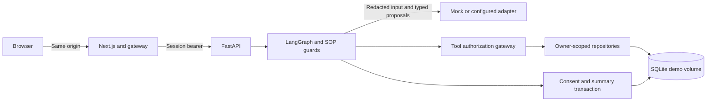
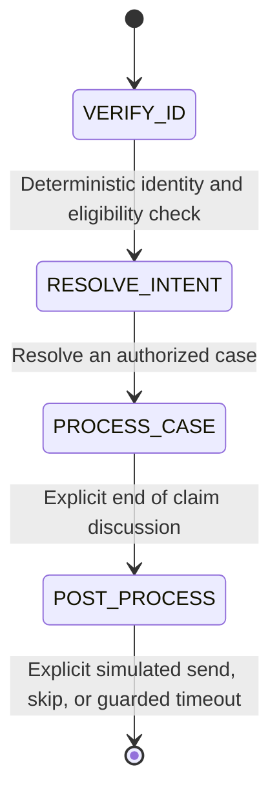
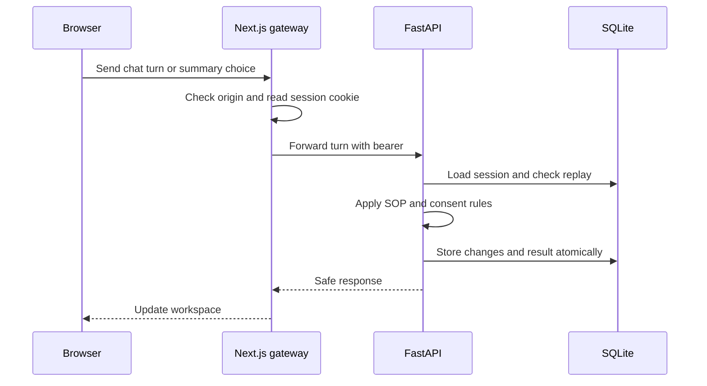
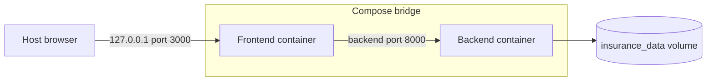

# Architecture

The browser communicates with Next.js on one origin. Server-side gateway routes validate mutation origins, keep the session bearer in an HttpOnly cookie, and forward authorized requests to FastAPI. Compose binds only the frontend to host loopback. The backend listens on the Compose network, with a named volume for SQLite.

A message is bound to a session and an idempotency key. The verifier requires three distinct matching fields from the same eligible party. Policy and relationship only select or restrict the lookup. Local code authorizes transitions and disclosures. The claim gateway checks eligibility and the repository repeats owner scoping in SQL. The case read feeds a deterministic evidence and response layer. The summary offer has a current revision, a registered masked recipient, and a single durable disposition per session. See [SPEC](../SPEC.md) for recovery and exceptional states.

Mock reasoning, handoff, and email are the default. The backend alone receives provider credentials. The configured OpenAI transport is opt-in and has an offline HTTP contract test. Incomplete verification values live in process memory. Durable SQLite state includes session state, idempotency records, and summary dispositions. See [deployment](DEPLOYMENT.md) for runtime evidence and [security audit](SECURITY_AUDIT.md) for production limits.

